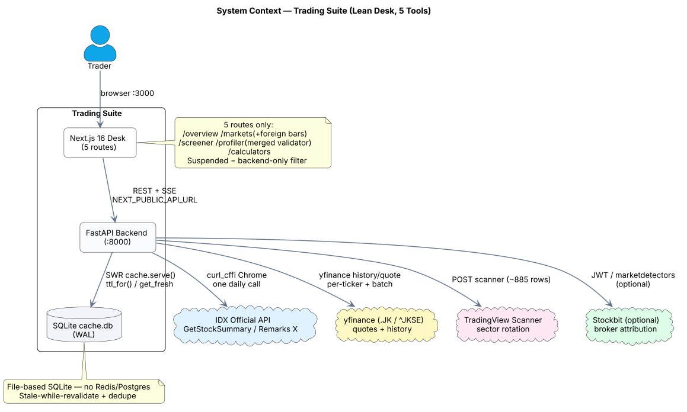
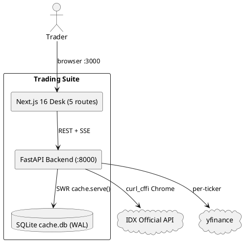
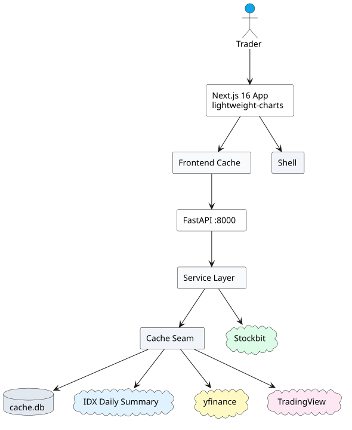
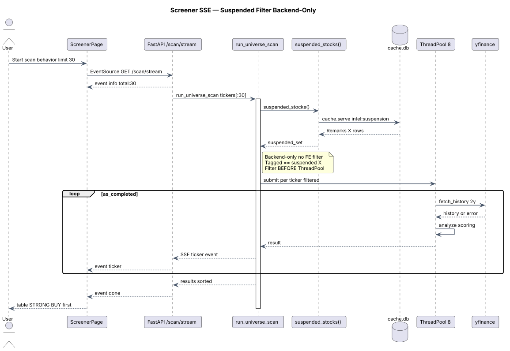

# Trading Suite — IDX Lean Desk (5 Routes)

> Self-hosted Indonesian stock platform, **simplified**. 22 tools → **5 routes** + backend-only suspended filter. No bloat, no Redis, just SQLite WAL + SWR caching and a one-command runner.

```
┌─────────────┐    /api/* + SSE     ┌──────────────┐     ┌─────────────────────┐
│ Next.js 16  │ ──────────────────▶ │ FastAPI :8000│────▶│ IDX / yfinance /    │
│ :3000 (5)   │◀────────────────── │ cache.serve()│     │ TradingView / SB    │
└─────────────┘  stale-while-reval  └──────┬───────┘     └─────────────────────┘
                                           │ WAL
                                    ┌──────▼───────┐
                                    │ cache.db     │
                                    │ kv_cache     │
                                    └──────────────┘
```

**Quick start — one command:**

```sh
chmod +x ./trading-suite
./trading-suite run     # backend :8000 + frontend :3000 (dev, hot-reload)
# open http://localhost:3000  → 5 cards: Overview / Markets (+foreign bars) / Screener / Profiler (merged) / Calculators
./trading-suite stop    # kill both
./trading-suite logs    # tail -f /tmp/trading-suite/*.log
```

Or raw:

```sh
backend/.venv/bin/python -m uvicorn app.main:app --host 127.0.0.1 --port 8000 --reload --app-dir backend &
npm run dev   # :3000, NEXT_PUBLIC_API_URL=http://localhost:8000
```

---

## Architecture — 1 Main + 2 Supporting Diagrams

> All PlantUML sources are in `docs/architecture/*.puml` with `skinparam backgroundColor white` (clear, printable). Rendered SVGs live alongside (`*.svg`). Re-render: `curl -X POST https://kroki.io/plantuml/svg --data-binary @docs/architecture/01-system-context.puml -o docs/architecture/01-system-context.svg`.

### Main Diagram — System Context (Lean Desk)

Shows the lean boundary: 5 UI routes, FastAPI, file-based SQLite, and four upstreams. Suspended/tagged is **backend-only** (no UI).



*Source: `docs/architecture/01-system-context.puml`* — 5 routes only (`/overview`, `/markets` with foreign bars, `/screener`, `/profiler` merged validator, `/calculators`). Backend `cache.serve()` fans out to IDX (one `GetStockSummary` daily call, Remarks trailing `X` = suspended), yfinance, TradingView, and optional Stockbit.



### Supporting Diagram A — Container & Caching (Frontend + Backend SWR)

How one logical cache seam serves both layers cheaply.



*Source: `docs/architecture/02-containers.puml` + `docs/architecture/06-caching.puml`* — Frontend `src/lib/cache.ts:TTL_TABLE` mirrors backend `app/cache.py:TTL_POLICY` (longest-prefix). Frontend: `mem → sessionStorage → network` (stale-while-revalidate + dedupe, 400k guard). Backend: `cache.serve(key, fetcher)` → `get_fresh` → stale return + `_spawn_refresh` daemon → miss blocks. Only survivors have TTLs (indices 45s,quotes 60s,history 120s,foreign 3600s,stockbit 43200s,validator 60s,screener 30s). Prefetch trimmed to `BBCA quote + 1y history` only. SQLite at `backend/data/cache.db` (WAL, per-thread conn, prune 5k/30d).

Supporting details: `docs/architecture/02-containers.puml` (container view) and `docs/architecture/03-backend-components.puml` (routers → services → cache seam) and `docs/architecture/06-caching.puml` expand this.

### Supporting Diagram B — Screener SSE with Suspended Backend-Only Filter

The only place suspended/tagged appears — filtered *before* the ThreadPool, never in UI.



*Source: `docs/architecture/05-sequence-screener.puml`* — `run_universe_scan()` loads `suspended_stocks()` (Remarks trailing `X`, `intel:suspension` cached 1h), builds `suspended_set`, filters `tickers = [t for t in tickers if t not in suspended_set]` pre-scan, then `ThreadPoolExecutor(8)` streams `SSE ticker` events. Tagged == suspended (single signal). Testable via `excluded` param.

Markets twin: `docs/architecture/04-sequence-markets.puml` — candle history SWR + LPM/Intensity toggle fix (teardown before early-return, `removeSeries` + `scaleMargins` reset) + foreign flow bars collapsible (disabled = `interval null`, no fetch; enabled = lazy `GET /api/intel/foreign/universe`, one IDX call).

---

## What Changed (Lean)

| Before (22 apps) | After (5 routes) | Where |
| --- | --- | --- |
| 22 APPS across 4 groups | 5 APPS: Overview, Markets, Screener, Profiler, Calculators | `src/lib/apps.ts`, `src/components/Sidebar.tsx` |
| Markets: LPM stuck on | Fixed: `MarketChart.tsx` tears down on toggle-off | `src/components/MarketChart.tsx` |
| Foreign flow separate page | Collapsible panel inside Markets, Enable/Disable, no poll when disabled | `src/components/ForeignBarsPanel.tsx`, `src/app/markets/page.tsx` |
| Validator standalone | Merged into Profiler (`ValidatorDetail` + `StockbitBrokerPanel`) | `src/app/profiler/page.tsx` |
| Suspended has UI | Backend-only: `GET /api/intel/suspended` stays, `src/app/suspended` deleted, screener excludes | `backend/app/screener.py`, `backend/app/idx.py`, `next.config.ts` redirects |
| 15 sunset pages | Hard redirects in `next.config.ts` (e.g. `/foreignflow→/markets`, `/brokerintel→/profiler`) | `next.config.ts` |
| Prefetch 5 tickers × 4 periods | Prefetch BBCA only | `src/components/Shell.tsx` |
| TTL for 20 feeds | TTL for 10 survivors only | `src/lib/cache.ts` |

---

## Monorepo Layout

| Path | What it is |
| --- | --- |
| `src/app/{overview,markets,screener,profiler,calculators}` | **Lean Next.js 16 routes** (only survivors) |
| `src/lib/apps.ts` | Single source for nav (5 APPS) |
| `src/lib/cache.ts` | Frontend SWR cache (mem + sessionStorage) |
| `src/components/{MarketChart,ForeignBarsPanel,Shell,Sidebar}` | Chart + new foreign bars panel |
| `backend/app/routers/` | FastAPI routers: `market, intel, screener, validator, analysis, regime` |
| `backend/app/{market,idx,screener,validator,stockbit,cache,db}.py` | Services + cache seam |
| `backend/config/tickers.py` | 900+ IDX universe |
| `backend/data/cache.db*` | SQLite WAL cache (gitignored) |
| `docs/architecture/` | PlantUML sources (`*.puml`, white bg) + rendered `*.svg` |
| `trading-suite` / `trading-suite.sh` | One-command runner (`run/dev/build/start/stop/logs/clean`) |
| `legacy/`, `pilot/` | Archived repos (not in lean nav) |

## Prerequisites

- Python 3.11+ (`backend/.venv`), Node 22+, Docker optional.

## Setup

### Backend

```sh
cd backend
python -m venv .venv
.venv/bin/pip install -r requirements.txt
cp ../.env.example .env   # optional; runs empty
.venv/bin/python -m uvicorn app.main:app --host 127.0.0.1 --port 8000 --reload --app-dir .
# or
../trading-suite run
```

Health: <http://127.0.0.1:8000/api/health> · Swagger: <http://127.0.0.1:8000/docs>

### Frontend (Lean)

```sh
npm install
npm run dev   # :3000
# prod
npm run build && npm run start
```

Env: `NEXT_PUBLIC_API_URL=http://localhost:8000` (default).

## Environment Variables (all optional)

| Variable | Purpose |
| --- | --- |
| `STOCKBIT_JWT_TOKEN` / `STOCKBIT_USERNAME/PASSWORD` | Stockbit broker feed (else degraded msg) |
| `YFINANCE_CACHE_TTL` etc. | Override TTLs |
| `CORS_ORIGINS` | Allowed origins |
| `OPENCODE_GO_API_KEY` | AI summaries (fallback deterministic) |

## Data Sources & Caching

- **IDX**: `GetStockSummary` (one call → ~963 rows, foreign flow + Remarks `X` for suspended). `curl_cffi` Chrome + stale-while-revalidate.
- **yfinance**: `.JK` quotes/history via `fetch_history` (SWR, 12h history TTL).
- **TradingView**: sector rotation (5-min cache).
- **SQLite WAL** (`backend/data/cache.db`): per-feed TTLs above, `_spawn_refresh` dedupe, `prune 5k/30d`.

## API Endpoints (Lean Subset)

| Group | Endpoint | Notes |
| --- | --- | --- |
| Market | `GET /api/market/indices`, `/quote/{t}`, `/quotes`, `/history/{t}`, `/beta/{t}` | history returns `{history, indicators, momentum}` |
| Intel | `GET /api/intel/foreign/universe`, `GET /api/intel/foreign/{t}`, `GET /api/intel/suspended` | suspended stays backend/debug only |
| Intel/Stockbit | `GET /api/intel/stockbit/broker/{t}` | JWT optional |
| Screener | `GET /api/screener/scan/stream` (SSE), `GET /api/screener/analyze/{t}` | suspended filtered pre-ThreadPool |
| Validator | `GET /api/validator/{t}` | merged into profiler |
| Analysis/Regime | `GET /api/analysis/entry/{t}`, `GET /api/regime/snapshot` | profiler + overview |

## Pages (Lean)

| Route | Shows |
| --- | --- |
| `/` | Launcher (5 cards) |
| `/overview` | Indices strip, watchlist (60000ms poll relaxed), regime |
| `/markets` | Candles + SMA/EMA/Volume + LPM/Intensity (fixed toggles) + **Foreign Flow bars** (Enable/Disable) |
| `/screener` | SSE streamed scan (suspended backend-only) |
| `/profiler?ticker=BBCA` | Quote + chart + beta + regime + bandarmology + intent radar + broker panel + entry plan |
| `/calculators` | Client-only math |

Sunset routes redirect (e.g. `/foreignflow→/markets`, `/brokerintel→/profiler`, `/suspended→/screener`, `/validator→/profiler`, `/regime→/overview`).

## Runner (`trading-suite`)

```sh
./trading-suite run    # dev both
./trading-suite build  # next build + wiring + pytest
./trading-suite start  # prod
./trading-suite stop
./trading-suite logs
./trading-suite clean
```

Also as `trading-suite.sh` (same).

## Testing & Checks

```sh
npm run build                         # Next 16.3 turbopack
node scripts/check-feature-wiring.mjs # 5 APPS + lean markers
cd backend && .venv/bin/python -m pytest -q   # 39 passed
cd backend && .venv/bin/pyright .
```

## Operations

- Plans/specs never commit: `.gitignore` ignores `PLAN.md`, `plans/`, `docs/PLAN.md`, `specs/PLAN-*.md`, etc.
- Cache: file-based, safe on persistent host. Delete `backend/data/cache.db*` to reset.
- Deploy: `docker compose up -d --build` (backend :8000, frontend :3000).

## License

[MIT](LICENSE)
