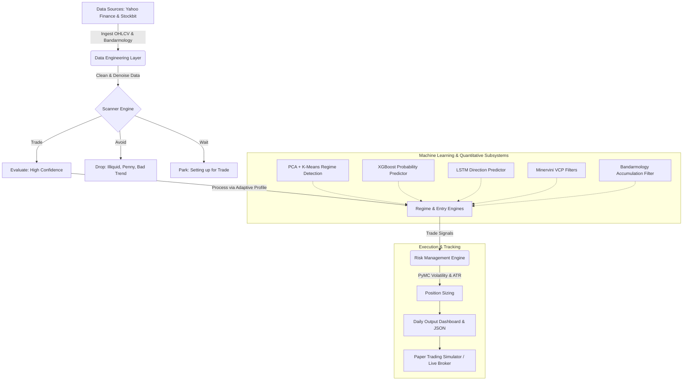

# Bot Trading Simulator Architecture

The Bot Trading Simulator is designed as a rigorous, accuracy-first swing trading application specifically for the Indonesian Stock Exchange (IHSG). It operates via a structured, multi-phase architecture heavily utilizing quantitative models, machine learning, and strict risk management.

## 1. Infrastructure & Data Engineering Layer
- **Source Files:** `core/ingestion.py`, `core/data_cleaner.py`
- **Responsibilities:**
  - Ingests daily OHLCV data for 591 curated IHSG tickers using rate-limited `yfinance` to prevent bans.
  - Fetches and tracks external signals such as **Bandarmology** data via the `StockbitClient` (`core/stockbit.py`).
  - **Storage:** Persists data locally in optimized Parquet format (`data/ohlcv/`).
  - **ML4T Denoising:** Utilizes Daubechies-4 Wavelet denoising with soft thresholding to remove high-frequency noise while preserving the trend structure, coupled with Kalman filter smoothing to provide an optimally smoothed "true" price estimate.
  - **Formulaic Alphas:** Calculates WorldQuant-inspired alphas (Momentum, Mean Reversion, Liquidity, Volatility Regime, Money Flow) entirely in numpy/pandas.

## 2. Scanner Engine & Adaptive Profiling
- **Source Files:** `core/scanner.py`, `core/adaptive.py`
- **Scanner (The "Tri-Bucket" Triage):**
  - **Avoid:** Discards illiquid (< IDR 2B ADTV), penny (< IDR 50), fundamentally unsafe, or severely downtrending stocks (>35% below SMA200), and blocks tickers under active **Failed Trade Cooldown**.
  - **Wait:** Monitors stocks forming tight consolidations, approaching Fair Value Gaps, or showing Wyckoff accumulation.
  - **Trade:** Highest conviction signals, limited to a max of 5 per day.
- **Adaptive Per-Stock Profiler:**
  - Instead of applying static thresholds (e.g., RSI < 30), it learns the unique characteristics of each ticker over a 2-year history.
  - Calculates stock-specific thresholds for Volume Spikes, RSI Overbought/Oversold levels, Typical Price Ranges, and Hurst exponents.

## 3. Market Regime & Entry Engines
- **Source Files:** `core/regime.py`, `core/engines.py`, `core/ml_engine.py`, `core/deep_engine.py`
- **Regime Detection:**
  - Traditional classification (BULL, CAUTION, BEAR) based on the Hurst exponent.
  - **Unsupervised ML Support:** PCA + K-Means clustering provides an unsupervised secondary opinion on the market regime with confidence scoring.
- **Entry Engines (Priority 1 to 3):**
  - **Priority 3 (ML):** XGBoost Entry (Predicts probability of success > 2% in 20 days based on alphas), LSTM Direction (Predicts upward movement probability).
  - **Priority 3 (Technical):** FVG Pullback.
  - **Priority 2:** Momentum Breakout (Minervini VCP enhanced), EMA Crossover, Volume Climax Reversal, Downtrend Bounce.
  - **Priority 1:** Buying on Weakness (B.O.W), Wyckoff Phase C Spring.

## 4. Quantitative Enhancements & Fundamentals
- **Source Files:** `core/fundamentals.py`, `core/valuation.py`
- **Code 33 & Graham Defensive Screening:** Screens out companies lacking consistent EPS/margin growth or exhibiting weak balance sheets (Current Ratio < 2.0).
- **Valuation Models:** Employs Gordon Growth Equation and Discounted Dividend Model (DDM) to penalize overvalued assets and confirm safety margins.

## 5. Risk Management Engine
- **Source Files:** `core/risk.py`, `core/portfolio.py`
- **Dynamic Position Sizing:** Default enforces a 2% capital risk exposure per trade. Adjusts scaling based on Market Regime (BULL: 100%, CAUTION: 50%, BEAR: 25%).
- **Bayesian Risk Assessment (PyMC):** Employs PyMC stochastic volatility models to estimate posterior market volatility distributions. Scales down position sizing in high-volatility regimes dynamically.
- **Stop-Loss Math:** Uses Deterministic ATR logic (1.5x ATR Stop-loss, 2.0x ATR Chandelier Trailing Stop).
- **Cardinal Sin Cap:** Hard cap ensuring no single trade loss can exceed 50% of the historical average gain per winning trade.

## 6. Execution, Backtesting, & State Management
- **Source Files:** `core/broker.py`, `core/backtester.py`, `core/paper_trader.py`, `core/json_tracker.py`
- **Paper Trading & Live Execution:** Simulates identical risk management routing, applying virtual bracket orders (Stop-loss + Take-profit at 2x ATR). State is precisely synchronized via Git-Ops, and repeated failures are prevented by a 30-day **Cooldown Manager**.
- **Backtesting Framework:** Event-driven architecture with zero look-ahead bias, employing automatic train/test splits (3.5 years / 1.5 years). Simulates precise IDX slippage and broker fees.
- **State Management:** All records (scan results, trade signals, paper trades, evaluations) are stored idempotently in local JSON (e.g., `data/daily_tracking.json`, `data/paper_portfolio.json`) and converted to human-readable Markdown.
