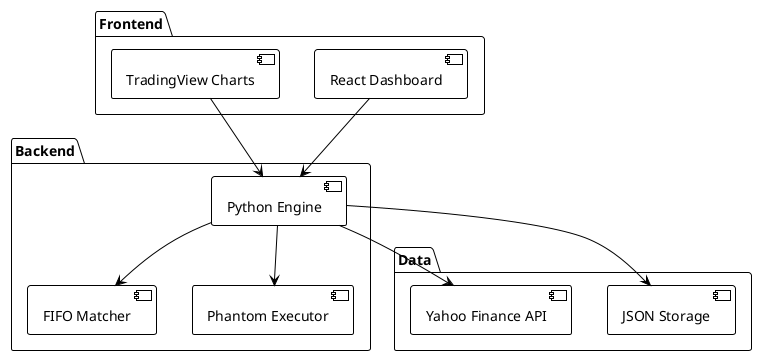
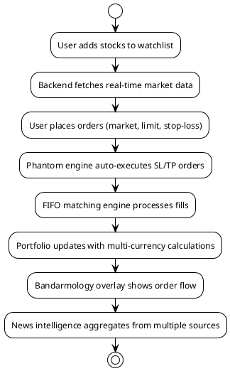

---
tags:
  - project
  - trading
  - finance
  - web
  - python
created: 2026-07-06
---

# trading-simulator

## Overview

**Repository:** [mariobgsp/trading-simulator](https://github.com/mariobgsp/trading-simulator)

Trading Simulator & Market Terminal. A comprehensive locally-first trading simulator with Bloomberg Terminal-style dashboard. Multi-currency portfolios (US Stocks, Crypto, IHSG) with IDR as master base currency. Features professional charting, market intelligence, and phantom order execution.

## Tech Stack

- **Backend:** Python (yfinance, pandas, google-generativeai)
- **Frontend:** React 19, TypeScript 6, Vite 8
- **Charts:** lightweight-charts (TradingView)
- **Testing:** Vitest, @testing-library/react
- **Data:** JSON files (watchlist, journal, pending orders)

## Architecture



## How It Works



## How to Run

### Prerequisites
- Python 3.10+
- Node.js 18+
- npm

### Installation
```bash
cd trading-simulator
pip install -r requirements.txt
cd dashboard
npm install
```

### Environment Setup
```bash
cp .env.example .env
# Fill in API keys if needed
```

### Run Backend
```bash
cd trading-simulator
python engine.py
```

### Run Frontend
```bash
cd trading-simulator/dashboard
npm run dev
```

### Access Dashboard
Open http://localhost:5173 in browser

## Key Files
- `engine.py` - Main trading engine with FIFO matching
- `backtester.py` - Historical backtesting
- `stockbit.py` - Stockbit API integration
- `news_service.py` - News aggregation
- `dashboard/` - React frontend application
- `requirements.txt` - Python dependencies
- `watchlist.json` - User watchlist

## Project Structure
```
trading-simulator/
├── engine.py               # Main trading engine
├── backtester.py           # Backtesting
├── stockbit.py             # API integration
├── news_service.py         # News aggregation
├── dashboard/              # React frontend
│   ├── src/
│   ├── package.json
│   └── vite.config.ts
├── requirements.txt        # Python dependencies
└── index.md                # This file
```


## Linked Files

### dashboard/
- [[trading-simulator/dashboard/README|README]]

### docs/
- [[trading-simulator/docs/superpowers/plans/2026-07-02-backtest-performance-graph|2026-07-02-backtest-performance-graph]]

### documentation/
- [[trading-simulator/documentation/ARCHITECTURE|ARCHITECTURE]]
- [[trading-simulator/documentation/PROJECT_DOCUMENTATION|PROJECT_DOCUMENTATION]]
- [[trading-simulator/README|README]]

## Related Projects
- [[main]] - Project index
